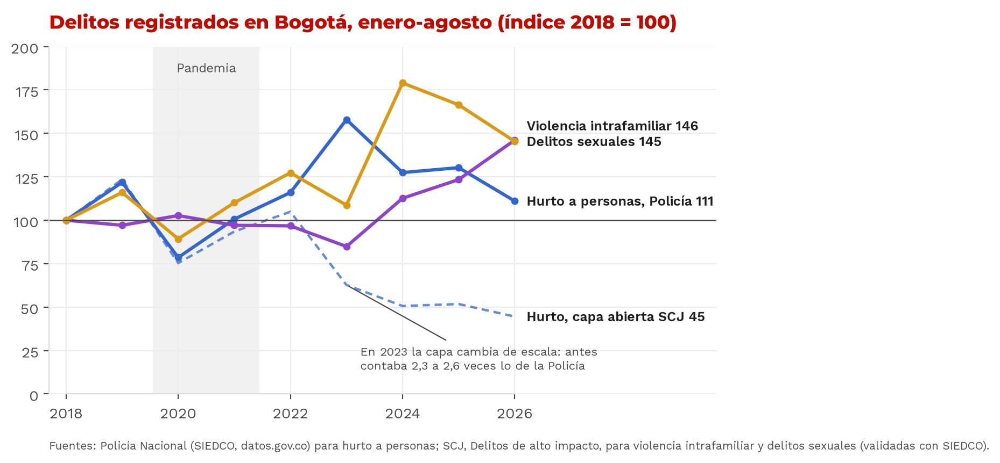

# El miedo que no baja

**Inseguridad percibida y delito registrado en Bogotá.**
Bogotá DataJam Edición 5 (2026) · Equipo #16 **The data squad**: Brandow Brusly León Rodríguez, Samuel Esteban Riveros Cubides y Rafael Estiven Londoño Camacho, estudiantes de Ciencia de Datos.

> **Todo en un solo lugar:** [`entregables/`](entregables/) reúne los documentos (Power BI, informe técnico, nota, formulario, Excel y pitch). [Video de 4 minutos](https://el-miedo-que-no-baja.vercel.app/video) · [Modelos](https://el-miedo-que-no-baja.vercel.app/modelos) · [](https://colab.research.google.com/github/rlondono1620-max/el-miedo-que-no-baja/blob/main/notebooks/colab_reproducir.ipynb)

| Entregable | Dónde |
|---|---|
| Notebook reproducible | [`notebooks/el_miedo_que_no_baja.ipynb`](notebooks/el_miedo_que_no_baja.ipynb) (ejecutado, con salidas) · en Colab: [`notebooks/colab_reproducir.ipynb`](notebooks/colab_reproducir.ipynb) |
| Visor interpretativo (web) | https://el-miedo-que-no-baja.vercel.app (clave en el correo de entrega) · código en [`visor/`](visor/) |
| Tablero Power BI | [`entregables/ElMiedoQueNoBaja.pbix`](entregables/) · proyecto editable en [`powerbi/`](powerbi/) |
| Libro de datos en Excel | [`docs/Libro_de_datos_El_miedo_que_no_baja.xlsx`](docs/) (tablas, fórmulas vivas y simulador) |
| Formulario de caracterización | [`docs/Formulario_caracterizacion_The_data_squad.docx`](docs/) |
| Nota técnica (1 página) | [`docs/Nota_tecnica_integracion_datos_The_data_squad.pdf`](docs/) |
| Informe técnico completo | [`docs/Informe_tecnico_El_miedo_que_no_baja.pdf`](docs/) |
| Video explicativo (4 min) | https://el-miedo-que-no-baja.vercel.app/video (capítulos y transcripción) · MP4 en [`visor/public/video/`](visor/public/video/) |
| Especificación de los modelos | https://el-miedo-que-no-baja.vercel.app/modelos |
| Presentación (clase interactiva) | modo **Presentar** del visor (`/presentar`, guion en `/presentar/guion`); respaldo sin internet en [`docs/pitch/`](docs/pitch/) (PDF y PPTX con notas) |
| Datos exportables (CSV, GeoJSON) | [`visor/public/descargas/`](visor/public/descargas/) y [`outputs/`](outputs/) |



## 1. Problema

El 74 % de los adultos califica Bogotá como insegura y el 48 % dice lo mismo de su propia zona (Encuesta Bienal de Cultura Ciudadana 2025). La lectura habitual es que el miedo «no acompaña» al delito, porque la capa abierta de la Secretaría de Seguridad muestra el hurto a personas 64 % abajo entre enero-agosto de 2019 y de 2026.

**Al validar esa serie, la premisa cambia.** Con el registro de la Policía Nacional (SIEDCO, datos.gov.co), el mismo hurto en los mismos meses está solo 9 % abajo frente a 2019 y 4 % frente a 2022, después de subir 36 % en 2023. De 2018 a 2022 la capa SCJ cuenta 2,3 a 2,6 veces lo que registra la Policía; desde 2023 coinciden caso por caso. La encuesta del DANE confirma la serie de la Policía: entre 2021 y 2023 la victimización por hurto no cambió (7,3 % frente a 6,9 %, p = 0,50) y la denuncia subió (36 % frente a 43 %). Mientras tanto, homicidios, delitos sexuales y violencia intrafamiliar suben en series validadas.

La política se planea y se evalúa con el delito registrado: una serie con un quiebre, sin el delito que no se denuncia y sin lo que forma la sensación de inseguridad.

**Pregunta analítica.** ¿Por qué la inseguridad percibida no baja cuando el delito registrado sí, y en qué territorios debe intervenir primero el Distrito?

**Hipótesis.**
- **H0.** Antes de comparar percepción y registro hay que validar que la serie del registro sea comparable en el tiempo.
- **H1.** La percepción del barrio depende más del entorno inmediato que del delito registrado en la localidad.
- **H2.** Parte de la distancia entre miedo y registro es subregistro: donde hay más miedo que delito registrado, más delito queda fuera de las cifras.
- **H3.** A igual victimización, las mujeres restringen más su vida y temen más el acoso sexual.

## 2. Hallazgos

0. **El hurto no bajó como parecía (H0).** Capa SCJ: −58 % de 2022 a 2026. Policía: −4 %. La diferencia es un quiebre de la serie en 2023, no un cambio en la calle: lo confirman la Policía, Medicina Legal (homicidios, 95 % a 100 % de coincidencia) y la encuesta del DANE. Para explicar la caída de la capa con menos denuncia, la denuncia del hurto habría tenido que bajar a cerca de 25 % en 2023; el DANE midió 43 %. Además, desde 2023 las columnas «motocicletas» y «celulares» de la capa repiten caso por caso el hurto a comercio y el de motos de la Policía. En series validadas, con binomial negativa de panel: homicidios +3,3 % al año (IC 95 % 0,5 a 6,1), delitos sexuales +7,5 % (3,0 a 12,2) y violencia intrafamiliar +11,2 % (4,1 a 18,9).
1. **La ciudad no ve buena parte de su delito.** Hay unas 5,6 víctimas (EMV 2024) por cada delito de alto impacto registrado (SCJ 2024, ya comparable): de cada 10 víctimas, 1,8 quedan en el registro. Con las encuestas del DANE y de la Cámara de Comercio la cuenta da cerca de 3 de cada 10; cambia el nivel, no la conclusión. La razón va de 10,6 en Bosa a 0,7 en Los Mártires, en parte porque el registro cuenta dónde ocurre el delito y la encuesta dónde vive la víctima. Entre localidades, las víctimas que reporta la encuesta no siguen al delito registrado (ρ = 0,03). **H2 no se sostiene:** el Índice de Brecha y la cifra oculta se correlacionan (ρ = 0,72), pero los dos se construyen con el delito registrado; controlando por él, la correlación parcial es prácticamente cero (−0,02). El miedo tampoco se parece a la cifra oculta (ρ = 0,16, no significativa). Lo reportamos como lo que es: una relación mecánica.
2. **El barrio se siente por lo que pasa en él.** Ver atracos en el parque cercano suma +13,3 pp a la probabilidad de sentir insegura la zona (IC 6,2 a 17,5), y los conflictos vecinales hasta +14,7 pp. El hurto registrado de la localidad no tiene efecto (wild cluster bootstrap p = 0,92). Con aprendizaje supervisado (bosque aleatorio y gradient boosting, validación cruzada 5 × 5), los hechos del entorno son el bloque que más acierto aporta, y el delito registrado no agrega información frente a saber la localidad de la persona (AUC 0,722 frente a 0,726).
3. **Alumbrado y vías no explican el hurto por localidad.** De 23 pruebas (luminarias, estado de la malla vial, alumbrado percibido), ninguna sobrevive a Benjamini-Hochberg; las dos más fuertes van al revés (más luminarias por km de vía, más hurto: es el centro). El inventario de luminarias sigue a la vía y no mide «peor alumbrado».
4. **Las mujeres: dos problemas distintos.** En la calle, a igual edad, estrato y victimización, tienen +18,0 pp de temor al acoso sexual y +6,5 pp de evitar salir de noche. En la casa, la violencia contra mujeres notificada al sector salud (SIVIM) subió 43 % entre 2019 y 2025 (IC 95 % 24 a 64 %), y 8 de cada 10 casos ocurren en la vivienda. Por eso el alumbrado y el internet público no se asocian con esa violencia por localidad (ρ = 0,02 y −0,28, ninguna significativa).
5. **Prioridad territorial.** Usme, Ciudad Bolívar, Bosa, Kennedy y San Cristóbal tienen el mayor Índice de Brecha y quedan en el top 5 en más del 90 % de las réplicas bootstrap. El índice ordena dónde actuar primero; no prueba causas. La tipología no supervisada agrupa a San Cristóbal, Usme y Ciudad Bolívar en un mismo perfil: miedo alto, pocas luminarias, más homicidios y pocas denuncias.

**Recomendaciones (cada una con su nivel de evidencia en el visor).**
- **Validar antes de decidir:** documentar el cambio de 2023 en los metadatos de la capa, publicar la serie empalmada y contrastar cada serie con la Policía y Medicina Legal. Es una recomendación técnica de documentación, no una evaluación de la entidad.
- Medir la seguridad con victimización (Encuesta Distrital de Percepción por UPL) y no solo con registros; asignar con víctimas estimadas, no solo con denuncias.
- Entornos que se sienten seguros (parques sin atracos, mediación de conflictos vecinales, alumbrado), priorizados con el Índice de Brecha y con un paquete conjunto para San Cristóbal, Usme y Ciudad Bolívar.
- Dos rutas para las mujeres: en la calle, rutas nocturnas y denuncia fácil del acoso; en la casa, detección en colegios y salud. Indicador de resultado: «% de mujeres que evita salir de noche».

## 3. Fuentes de datos

| Fuente | Entidad | Uso |
|---|---|---|
| [Delito de Alto Impacto. Bogotá D.C.](https://datosabiertos.bogota.gov.co/dataset/delito-de-alto-impacto-bogota-d-c) | Secretaría Distrital de Seguridad, Convivencia y Justicia | 11 delitos por localidad, enero-agosto 2018-2026 |
| [Incidentes reportados a la Línea 123](https://oaiee.scj.gov.co/agc/rest/services/Tematicos_Pub/CifrasSCJ/MapServer) | SCJ | Llamadas por narcóticos, riñas y maltrato a mujer, por localidad y UPZ |
| [Proyecciones de población 2005-2035](https://datosabiertos.bogota.gov.co/dataset/proyecciones-y-retroproyecciones-de-poblacion-2005-2035) | Secretaría Distrital de Planeación | Denominadores por localidad, UPZ, sexo y edad |
| [Encuesta Bienal de Cultura Ciudadana 2025](https://observatoriocultura.github.io/observatorio/#/ebc/encuesta-cultura-ciudadana-2025) | Secretaría de Cultura, Recreación y Deporte | Microdatos: percepción y entorno (5.538 adultos) |
| [Encuesta Mundial de Valores ola 8, 2024](https://gobiernoabiertobogota.gov.co/transparencia) | Secretaría General · Datos para la Transparencia | Microdatos: victimización y género (1.824 en Bogotá) |
| [Alumbrado público por localidad](https://datosabiertos.bogota.gov.co/dataset/alumbrado_publico_lt) | UAESP | Validación (último corte publicado: agosto 2019) |
| [Indicador de espacio público](https://datosabiertos.bogota.gov.co/dataset/indicador-espacio-publico-localidad-bogota-d-c) | DADEP | Contexto |
| [Localidad. Bogotá D.C.](https://datosabiertos.bogota.gov.co/dataset/localidad-bogota-d-c) | UAECD · IDECA | Límites |
| [Delitos por municipio (SIEDCO)](https://www.datos.gov.co/d/4rxi-8m8d) | Policía Nacional · MinDefensa | Validación del registro: hurtos, homicidios, lesiones, delitos sexuales y VIF de Bogotá, mes a mes |
| [Presuntos homicidios](https://www.datos.gov.co/d/vtub-3de2) | Medicina Legal (INMLCF) | Validación de homicidios |
| [Encuesta de Convivencia y Seguridad Ciudadana](https://www.dane.gov.co/index.php/estadisticas-por-tema/seguridad-y-defensa/encuesta-de-convivencia-y-seguridad-ciudadana-ecsc) | DANE | Victimización y denuncia de Bogotá con errores publicados |
| [Encuesta de Percepción y Victimización](https://www.ccb.org.co/) | Cámara de Comercio de Bogotá | Victimización y denuncia 2015-2025 (cifras transcritas con página y gráfico) |
| [Violencia intrafamiliar y de género (SIVIM)](https://datosabiertos.bogota.gov.co/) | Secretaría Distrital de Salud | Violencia contra mujeres notificada, 2013-2026 |
| [Seguridad nocturna para las mujeres](https://datosabiertos.bogota.gov.co/) | Secretaría Distrital de la Mujer | Auditoría nocturna 2019 (iluminación y senderos) |
| Encuesta de acoso sexual callejero 2025 | Veeduría Distrital | Acoso en la calle por sexo (formulario en línea: describe, no estima) |
| [Zonas wifi y centros CETIC](https://datosabiertos.bogota.gov.co/) | Secretaría General | Internet público por localidad |
| [Siniestralidad vial (SIGAT)](https://datos.movilidadbogota.gov.co) y mortalidad en tránsito | Secretaría de Movilidad · SDS con datos de Medicina Legal | Muertes, heridos y siniestros por localidad, 2015-2026 |
| [Estado de la malla vial (PCI)](https://www.idu.gov.co/) | IDU | Km-carril en mal estado por localidad (diciembre 2024 y junio 2026) |
| [Modelo de prestación de alumbrado público](https://datosabiertos.bogota.gov.co/dataset/alumbrado_publico_lt) | UAESP | 52 cortes del inventario de luminarias, 2017-2024 |

Cada fuente lleva un **score de confiabilidad (0-100)** con seis criterios: años comparables, actualidad, precisión, detalle territorial, validez y verificación externa (`src/confiabilidad.py`, `outputs/tablas/confiabilidad_fuentes.csv`). Las URL exactas de cada archivo están en `data/crudos/registro_descargas.csv` y en las notas `docs/notas/frente_victimizacion.md`, `docs/notas/frente_genero.md` y `docs/notas/frente_movilidad.md`.

La localidad de cada registro de la EMV no viene en el archivo publicado. Se recuperó del tablero oficial de Datos para la Transparencia (`data/crudos/emv_localidad_por_registro.csv`) y se verificó: 96 encuestas por localidad, como dice la ficha técnica.

## 4. Metodología

1. **Auditoría de datos.** Variable ideal frente a variable disponible, con proxy y limitación (sección 1 del notebook).
   - **Validación del registro antes de modelar:** razón capa SCJ ÷ SIEDCO y SCJ ÷ Medicina Legal por delito y año; una razón entre 0,95 y 1,10 cuenta como la misma serie (`src/validacion_registro.py`, sección 5 del notebook).
2. **Limpieza** por fuente con bitácora (`outputs/tablas/bitacora_limpieza.csv`):
   - formato ancho a largo;
   - normalización de la localidad al código oficial 1-20;
   - recodificación de escalas;
   - controles de totales.
3. **Integración** por código de localidad, con tasas por 100.000 habitantes (población SDP). A cada persona de la Bienal se le asigna el delito y las llamadas 123 de su localidad.
4. **Diagnóstico.** Logit ponderado con el factor de expansión, efectos marginales promedio en puntos porcentuales e IC 95 % por bootstrap de localidades.
   - **Modelo principal:** solo hechos del entorno, para evitar el sesgo de método común.
   - **Robustez:** efectos fijos de localidad, modelo lineal con wild cluster bootstrap (pesos de Webb) y otros dos resultados.
5. **Predictivo.** AUC fuera de muestra por bloques de variables, con validación cruzada estratificada repetida.
6. **Género.** Efecto de ser mujer con controles de victimización (EMV).
7. **Territorio.**
   - Validaciones con Spearman y corrección de Benjamini-Hochberg.
   - Cifra oculta.
   - **Índice de Brecha de Seguridad** = z(% zona insegura) − z(ln delitos de alto impacto por 100.000), con intervalos bootstrap.
8. **Tendencias.** Binomial negativa de panel (19 localidades, enero-agosto), efectos fijos de localidad, población como exposición y errores agrupados, en la ventana comparable de cada serie (`src/tendencias.py`).
9. **Aprendizaje supervisado y no supervisado.** Logística, bosque aleatorio y gradient boosting con importancia por bloques y prueba de contexto (`src/aprendizaje.py`); componentes principales y Ward con silueta y estabilidad (`src/tipologia.py`).
10. **Prescriptivo.** Escenarios del modelo (alumbrado y parques sin atracos) por localidad y sexo, y estrategias con nivel de evidencia.

## 5. Cómo ejecutarlo

Requisitos: Python 3.11 o superior. El visor necesita además Node 20 o superior.

```bash
git clone https://github.com/rlondono1620-max/el-miedo-que-no-baja.git && cd el-miedo-que-no-baja
python -m venv .venv && source .venv/bin/activate   # Windows: .venv\Scripts\activate
pip install -r requirements.txt

# Opción A: todo el pipeline (≈ 6 min; los bootstraps son lo más lento)
python src/pipeline.py

# Opción B: el notebook paso a paso
jupyter notebook notebooks/el_miedo_que_no_baja.ipynb

# Después: libro de Excel y presentación del pitch (leen outputs/)
python src/excel.py                  # en Windows usa Excel para guardar los valores; --sin-excel lo omite
python docs/pitch/capturar_presentacion.py   # con el visor corriendo en local (VISOR_SIN_CLAVE=1)
```

- **Descarga de datos:** `src/fuentes.py` baja cada fuente desde su servicio oficial y la deja en `data/crudos/`, con registro de URL, fecha y sha1. Si el archivo ya existe, usa la copia local, así que el análisis corre sin red con los datos incluidos en el repositorio.
- **Resultados idénticos:** las semillas están fijas, así que dos corridas dan las mismas cifras.
- **En Windows:** clona en una ruta corta (por ejemplo `C:\proyectos\el-miedo-que-no-baja`) o habilita las rutas largas del sistema. Algunas dependencias, como scikit-learn, tienen rutas internas muy profundas y su instalación falla en silencio si se supera el límite de 260 caracteres.

## 6. Despliegue del visor

```bash
cd visor
npm install
VISOR_CLAVE=<clave> VISOR_SECRETO=<cadena-aleatoria> npm run dev   # local en http://localhost:3210
vercel deploy --prod                                                 # producción (Vercel)
```

- **Datos del visor:** el pipeline los regenera en `visor/data/visor.json` y `visor/public/descargas/`. Después de correr el pipeline basta con volver a desplegar.
- **Acceso con clave:** lo controla `visor/proxy.ts`. La sesión dura 30 días, va firmada con HMAC-SHA256 y la clave se configura en las variables de entorno de Vercel.

## 7. Estructura del repositorio

```
data/
  crudos/          fuentes oficiales descargadas + registro_descargas.csv
  procesados/      tablas limpias e integradas (panel por localidad, microdatos analíticos)
notebooks/         el_miedo_que_no_baja.ipynb (ejecutado)
src/
  fuentes.py       descarga con caché desde los servicios oficiales
  territorio.py    llave territorial (normalizador de localidades)
  limpieza.py      limpieza por fuente con bitácora
  indicadores.py   integración, tasas, cifra oculta, Índice de Brecha, validaciones
  modelos.py       logit ponderado con AME, wild bootstrap, AUC por bloques, escenarios
  figuras.py       figuras PNG
  exportar.py      JSON del visor, CSV/GeoJSON descargables, tablas Power BI
  excel.py         libro de datos en Excel (tablas, fórmulas vivas, simulador)
  clase.py         datos de la presentación interactiva (coeficientes, réplicas, índice por partes)
  fuentes_victimizacion.py  SIEDCO, Medicina Legal, DANE y CCB: contraste del registro y victimización
  fuentes_genero.py         SIVIM, seguridad nocturna, acoso callejero e internet público
  fuentes_movilidad.py      siniestralidad vial, malla vial, luminarias y cicloinfraestructura; pruebas de la hipótesis de alumbrado y vías
  validacion_registro.py    reglas de comparabilidad de cada serie (quiebre de 2023, columnas cruzadas)
  tendencias.py    binomial negativa de panel en la ventana comparable
  aprendizaje.py   aprendizaje supervisado (AUC, importancia por bloques, prueba de contexto)
  tipologia.py     aprendizaje no supervisado (componentes principales, Ward, estabilidad)
  confiabilidad.py score de confiabilidad de las fuentes y nivel de evidencia
  frentes.py       exporta los frentes y modelos al visor
  pipeline.py      orquestación de punta a punta
outputs/
  figuras/         figuras del informe
  tablas/          resultados de cada modelo y validación (CSV)
  geo/             GeoJSON con indicadores (localidad y UPZ)
  resultados.json  cifras que citan el visor, el formulario y el pitch
visor/             visor web Next.js (desplegado en Vercel)
powerbi/           proyecto de Power BI y tablas que consume
docs/              formulario, nota técnica, libro de Excel, ficha del indicador y material del pitch
assets/fuentes/    Montserrat y Work Sans (licencia OFL) para que las figuras se vean igual en cualquier equipo
auditoria_portal/  scripts de auditoría del catálogo completo del portal (cifras de la nota técnica)
```

## 8. Limitaciones

- **Asociación, no causalidad.** El simulador es una sensibilidad del modelo.
- **Quiebre de la capa SCJ en los hurtos.** No es comparable antes y después de 2023; el método de 2018-2022 no está documentado. Las tendencias de hurto usan el SIEDCO (Bogotá) o la ventana 2023-2026 (localidades).
- **Encuestas de victimización con huecos.** El DANE no tiene 2022 ni 2024-2026 y cambió el mes de campo en 2019; la Cámara de Comercio no publica errores por indicador.
- **SIVIM cuenta casos notificados**, no personas; desde 2022 crece la notificación escolar. La encuesta de acoso es un formulario en línea (autoselección).
- **Tipología con estructura débil** (silueta ≈ 0,16): describe, no infiere.
- **Sesgo de método común.** Las calificaciones de alumbrado y ventas informales comparten batería con la seguridad de la zona: se reportan aparte.
- **Inventario de alumbrado viejo:** es de 2019 y por localidad, así que no permite validar el efecto del alumbrado.
- **Muestra de la EMV:** 96 encuestas por localidad, con factor de ponderación nacional. La cifra oculta compara personas con hechos y se lee como orden de magnitud.
- **Delito solo por localidad.** La Encuesta Distrital de Percepción 2025 no se pudo descargar en forma automatizada; es la fuente propuesta para el seguimiento por UPL.

## Licencia

Código bajo licencia MIT. Los datos son de las entidades distritales citadas y se usan bajo sus condiciones de datos abiertos.
