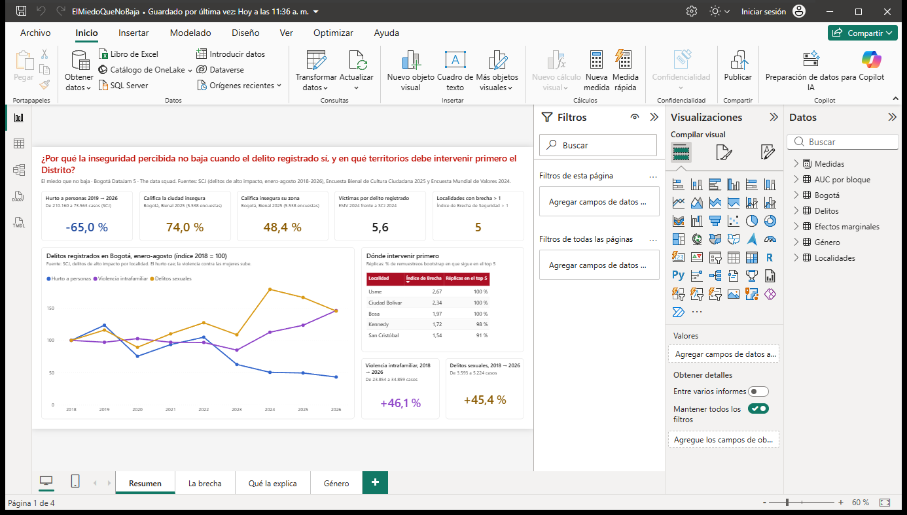

# Tablero Power BI · El miedo que no baja

Tablero del proyecto **«El miedo que no baja»** (Bogotá DataJam 5, equipo The data squad): inseguridad percibida frente a delito registrado en Bogotá.

> **Pregunta analítica.** ¿Por qué la inseguridad percibida no baja cuando el delito registrado sí, y en qué territorios debe intervenir primero el Distrito?



## Cómo abrirlo

- **Para ver el tablero:** doble clic en `ElMiedoQueNoBaja.pbix` (Power BI Desktop). Abre con los datos cargados.
- **Para editarlo:** abra `ElMiedoQueNoBaja.pbip`. Si Power BI no encuentra los datos, cambie el parámetro `RutaDatos`
  (Inicio → Transformar datos → Editar parámetros) por la ruta de la carpeta `datos/` de esta misma carpeta, terminada en `\`.

## Qué contiene

| Archivo o carpeta | Para qué sirve |
|---|---|
| `ElMiedoQueNoBaja.pbix` | **El archivo para el jurado.** Abre con los datos ya cargados, sin depender de rutas. |
| `ElMiedoQueNoBaja.pbip` | Proyecto Power BI en formato texto (PBIP). Abre el mismo informe desde las dos carpetas siguientes. |
| `ElMiedoQueNoBaja.SemanticModel/` | Modelo semántico en TMDL: tablas, consultas Power Query, parámetro `RutaDatos` y medidas DAX. |
| `ElMiedoQueNoBaja.Report/` | Informe en PBIR (carpeta `definition/`: una carpeta por página y por visual) y el tema propio. |
| `datos/` | CSV de entrada (UTF-8, punto decimal). |
| `tema_el_miedo_que_no_baja.json` | Tema de colores y tipografía. Ya está aplicado; esta copia sirve para usarlo en otro informe (Ver > Temas > Buscar temas). |
| `captura_powerbi.png` | Captura de Power BI Desktop con el informe cargado. |

## Páginas del informe

1. **Resumen.** La pregunta analítica, cinco tarjetas calculadas sobre los datos (variación del hurto a personas ene-ago 2019 → 2026, % que califica la ciudad y su zona como inseguras, víctimas por cada delito registrado y localidades con Índice de Brecha > 1), la serie de delitos registrados (hurto a personas, violencia intrafamiliar y delitos sexuales, índice 2018 = 100), el top 5 de localidades donde intervenir primero y la variación 2018 → 2026 de violencia intrafamiliar y delitos sexuales.
2. **La brecha.** Índice de Brecha de Seguridad por localidad (ordenado), dispersión «% que califica insegura su zona» frente a «delitos de alto impacto por 100 mil» (eje horizontal en escala logarítmica) y tabla con Índice de Brecha, cifra oculta, zona insegura y delitos por 100 mil.
3. **Qué la explica.** Efectos marginales (puntos porcentuales) del modelo «Hechos del entorno», con su tabla de intervalos de confianza, y AUC fuera de muestra por bloque de variables.
4. **Género.** Indicadores de la EMV 2024 para mujeres y hombres, el efecto de ser mujer a igual edad, estrato y victimización, y la tabla por localidad de «califica insegura su zona» por sexo.

## Colores

Paleta del Distrito de Bogotá, validada para daltonismo. Tipografía Segoe UI. Números con formato colombiano (coma decimal, punto de miles).

| Uso | Color |
|---|---|
| Percepción (barras, líneas, puntos) | oro `#D99A16` |
| Percepción en cifras y texto sobre blanco | `#8A5A00` |
| Registro oficial (barras, líneas, puntos) | azul institucional `#3366CC` |
| Registro oficial en cifras y texto | `#1F4A9E` |
| Mujeres / hombres | violeta `#8E44C8` / verde `#2A9D4B` |
| No significativo | gris `#B9B9B9` |
| Títulos de página y etiquetas de sección | rojo Bogotá `#BF0A00` |
| Encabezados de tabla | vino `#AB0F24` con texto blanco |
| Texto principal / secundario | `#1E1E1E` / `#4B4B4B` |
| Fondo de página / borde de tarjetas | blanco / `#E3E3E3` |

Los colores que dependen del dato se aplican en el informe: Índice de Brecha y efectos marginales con reglas de formato condicional sobre las mismas medidas numéricas (Índice de Brecha, IC 95 % inferior y superior, efecto), y AUC con un color fijo por bloque que `generar_pbip.py` calcula con la misma lógica. Las medidas «Color Índice de Brecha», «Color efecto marginal» y «Color AUC» siguen en el modelo con los hex de la primera paleta, pero ningún visual las usa: cambiarlas habría alterado el modelo del `.pbix`.

## Cómo abrirlo

- **`.pbix`**: doble clic. Requiere Power BI Desktop actualizado (probado con la versión 2.158.1177, octubre de 2026). No hace falta actualizar datos.
- **`.pbip`**: doble clic en `ElMiedoQueNoBaja.pbip`. Si aparece el aviso «Algunas de las tablas tienen datos incompletos o no tienen datos», pulse **Actualizar ahora**. Antes, si la carpeta no está en la ruta original, cambie el parámetro `RutaDatos` (siguiente sección). La caché de datos del proyecto (`.pbi/cache.abf`) no se sube al repositorio, por eso al clonar el proyecto abre sin datos hasta la primera actualización.

## Cómo cambiar la ruta de datos

Las seis consultas leen los CSV desde el parámetro de texto **`RutaDatos`**. Su valor por defecto es la ruta absoluta de la carpeta `datos/` en el equipo donde se construyó:

```
C:\Users\rafal\OneDrive\Desktop\Projects\datajam-miedo-que-no-baja\powerbi\datos\
```

Para cambiarla:

1. En Power BI Desktop: **Inicio > Transformar datos** (abre el Editor de Power Query).
2. **Inicio > Administrar parámetros > `RutaDatos`**. Atajo sin abrir el editor: Inicio > Transformar datos (flecha) > **Editar parámetros**.
3. Escriba la ruta completa de la carpeta `datos` en su equipo. Puede terminar o no en `\`.
4. **Cerrar y aplicar** (o **Actualizar** en la cinta). Las seis tablas se recargan.

## Cómo exportar a .pbix

El `.pbix` incluido se generó así desde el proyecto abierto:

1. Abra `ElMiedoQueNoBaja.pbip` con los datos cargados.
2. **Archivo > Guardar como** (o **F12**).
3. En **Tipo**, elija **Archivo de Power BI (\*.pbix)** y guarde.

## Modelo

| Tabla | Filas | Origen |
|---|---|---|
| `Localidades` | 19 | `dim_localidad_indicadores.csv` (una fila por localidad urbana) |
| `Delitos` | 98 | `fact_delitos_serie.csv` (Bogotá, enero-agosto 2018-2026) |
| `Efectos marginales` | 26 | `fact_efectos_marginales.csv` (dos modelos) |
| `AUC por bloque` | 6 | `fact_auc_bloques.csv` (+ columna `orden` con el orden del archivo) |
| `Género` | 4 | `fact_genero_emv.csv` (+ etiqueta legible y orden) |
| `Bogotá` | 17 | `dim_bogota.csv` (ver abajo) |
| `Medidas` | 0 | Tabla solo para las 59 medidas, en carpetas: Resumen, Serie de delitos, Localidad, Modelo, Género y Textos. |

- No hay relaciones: cada tabla responde a una pregunta distinta (serie de la ciudad, panel de localidades, resultados de modelos) y no comparten llave.
- Tipos fijados en Power Query con cultura `en-US`, así los decimales con punto de los CSV se leen bien en cualquier equipo.
- Las medidas «por localidad» (Índice de Brecha, cifra oculta, % zona insegura…) devuelven el valor de **una** localidad y quedan en blanco si hay varias en contexto, para no sumar ni promediar porcentajes sin querer. Donde un promedio sí sirve de referencia está rotulado: *Zona insegura, promedio simple de localidades* y *Ciudad insegura, promedio simple de localidades*. **No** son el dato de Bogotá.
- **`dim_bogota.csv`** trae las cifras de Bogotá que no se pueden calcular con los datos por localidad: los % de la Bienal 2025 y los efectos de ser mujer de la EMV 2024 salen de los microdatos con su factor de expansión. Se copian tal cual de las salidas del pipeline del proyecto (`outputs/resultados.json` y `outputs/tablas/cifra_oculta.csv`) con `_build/derivar_bogota.py`; cada fila indica de dónde sale.
- El resto de cifras del tablero (variación del hurto, índices de la serie, conteo de localidades, tops) se calculan con DAX sobre los CSV.

## Regenerar desde cero

```
python powerbi/_build/derivar_bogota.py   # datos/dim_bogota.csv
python powerbi/_build/generar_pbip.py     # .pbip + SemanticModel (TMDL) + Report (PBIR)
```

`generar_pbip.py` reescribe el modelo y el informe, así que cualquier ajuste hecho a mano en Desktop se pierde. Al guardar, Power BI Desktop normaliza los archivos (agrega `diagramLayout.json`, `cultures/es-CO.tmdl` y la carpeta `.pbi/`); es lo esperado.

## Validación hecha

- Los 37 JSON del informe se validaron contra los esquemas PBIR que trae Power BI Desktop 2.158 (report 3.3.0, page 2.1.0, visualContainer 2.13.0): 0 errores.
- El `.pbip` y el `.pbix` se abrieron en Power BI Desktop 2.158.1177 sin errores de esquema. Por TOM/ADOMD contra el Analysis Services local: las 6 tablas de datos con sus filas (19, 98, 26, 6, 4 y 17), sin columnas en blanco, y las 59 medidas evaluadas sin error, también por localidad, año, variable del modelo, bloque e indicador de género.
- Se revisaron las cuatro páginas con capturas de la ventana de Desktop.
- Cambio a la paleta del Distrito (octubre de 2026): solo se tocó el informe. El `DataModel` del `.pbix` es idéntico byte a byte al anterior (SHA-256 `4a517c59…8a24af`), los JSON del informe dentro del `.pbix` son los mismos del PBIP y pasan los esquemas de Desktop 2.158; las reglas de color se validaron además contra la definición de expresiones de `semanticQuery`. El `.pbix` se abrió en Desktop y se revisaron las cuatro páginas.
